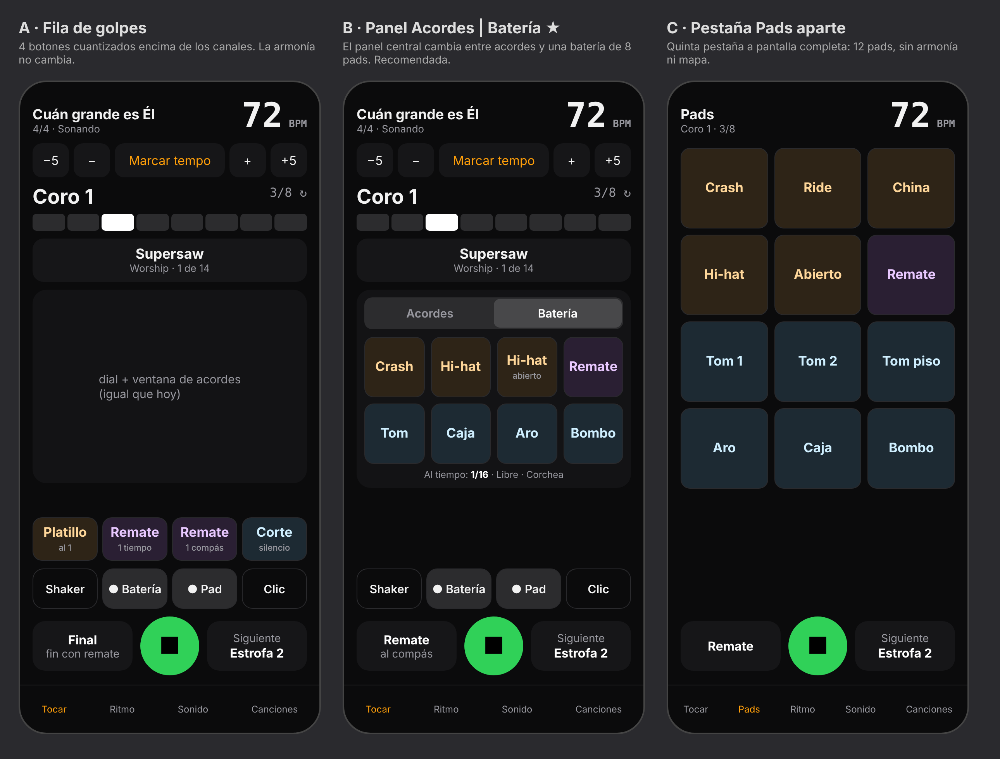

# Diseño e interfaz

Tokens de color, tamaños y orden de la pantalla Tocar: README §6 (Diseño iOS oscuro). Mapa de pantallas: [funciones.md](funciones.md).

## Lo que ya está decidido
- **Aspecto iOS oscuro**, fuente del sistema, monoespaciada para BPM y dial.
- **Tocar = diseño C5a** (2026-10-27): elegido por Frederik entre prototipos. Canvas: https://claude.ai/artifact/W76VuJ8qYhxD3943SBPwFd · prototipo aprobado: https://claude.ai/artifact/61bLWxJQcPGdW9SWzabWtS
- **Zona del pulgar:** canales y transporte abajo; nunca suben. Play visible sin desplazar desde iPhone SE hasta Pro Max.
- **Objetivos táctiles ≥ 44 px** (Apple HIG); Play 76 px; canales 56 px.
- **Menús pull-down estilo iOS**, nunca el selector nativo.
- **Paneo plegable** en Sonido › Mezcla, sin diagrama L/R (pedido de Frederik).
- **Editor de parte:** acordes primero, luego cuántos compases (Frederik encontró confuso el primer editor).
- **Tocar un control abre su lista ahí mismo** (tonalidad, pad): práctico en vivo.

## Problemas de diseño conocidos
La auditoría completa de la interfaz, con hallazgos H1–H10, está en la sección de principios más abajo.
| Problema | Evidencia | Fase |
|---|---|---|
| La estructura con acordes está escondida: Sonido (3.ª pestaña) › bajar hasta Estructura › pestaña Partes (no es la que abre) › tocar una parte. | Comentario de Ariel (F-2026-11-22-3); [auditoría](auditorias/2026-11-23-codigo.md#2-acordes-por-parte) | Fase 2 |
| Con los valores por defecto (Manual + Tónica + 5ª) los acordes de las partes no suenan, sin aviso. | `src/engine.js:381`, `:1003-1009` | Fase 2 |
| El texto de Sonido › Estructura › Partes dice "la app pasa sola a la parte siguiente", falso desde 1.7.0 (Avanzar viene apagado). | `src/engine.js:218` y `:278` | Fase 2 |
| Diseño solo para teléfono: en tablet y computadora se ve raro. | Pruebas de Frederik 2026-11-08 | pendiente |

## Principios de UX para apps musicales en vivo

> Hilo "Base de diseño", Fase 0 (2026-11-23), [PR #10](https://github.com/Frederikfor/M-Companion/pull/10). Es el criterio para decidir dónde va cada botón. Cada principio (`P#`), hallazgo (`H#`) y fuente (`S#`) tiene un identificador estable: cítalo en commits y PRs. Nada de esto está implementado todavía; las decisiones abiertas están en [decisiones.md](decisiones.md).

| Subsección | Úsala cuando… |
|---|---|
| Para quién y en qué contexto | dudes si una función encaja |
| Principios de diseño (P1–P10) | diseñes o revises cualquier pantalla |
| Mapa de la interfaz actual (1.8.0) | busques dónde vive una función hoy |
| Auditoría: hallazgos (H1–H10) | priorices arreglos de interfaz |
| Pad de batería: opciones y recomendación | trabajes en la Fase 4 |
| Lista de verificación para cualquier cambio de interfaz | antes de un PR que toque `src/ui.html` |
| Herramientas de diseño (skills y plugins) | quieras una revisión asistida |
| Fuentes (S1–S14) | necesites justificar una decisión |

### Para quién y en qué contexto

- **Usuario principal:** cantante que toca guitarra (a veces piano) en un servicio de iglesia, solo o con un grupo pequeño. Tiene las **dos manos ocupadas** con el instrumento la mayor parte del tiempo.
- **Dónde se usa:** teléfono en un atril o en el piano, a 40–70 cm, con poca luz y a veces con luces de escenario encima; conectado a la mezcladora con cable. Se toca con **un dedo, en un momento libre** (entre frases, al final de un compás).
- **Qué es:** un acompañante en vivo (shaker, batería, pad, clic) que sigue al músico. **Qué no es:** un DAW, un secuenciador ni un reproductor de multitracks (ver README §6, regla 1). La petición de unir multitrack con videokaraoke (Facebook, 2026-11) queda fuera por esta razón.
- **Lo que pidió la gente** (comentarios de Facebook, 2026-11): mejor sonido de batería; asignar acordes por parte desde la pantalla principal; un **pad de batería** tocable.

### Principios de diseño (P1–P10)

Cada principio dice qué hacer y de dónde sale. Si una propuesta rompe uno, debe decir cuál y por qué.

**P1. Un toque, un resultado, sin mirar dos veces.** En vivo cada acción importante es un solo toque sobre un objetivo grande, y su efecto se ve y se oye. Nada de gestos ocultos para algo crítico (doble toque, deslizar) sin un botón equivalente. *Fuente:* S1, S3.

**P2. Objetivos táctiles ≥ 44 pt, en vivo ≥ 56 pt.** Apple pide 44×44 pt (S1), Material 48×48 dp ≈ 9 mm con 8 dp de separación (S2), NN/g 1×1 cm (S3); WCAG 2.2 fija 24 px como mínimo absoluto (S4). En Tocar, con el teléfono lejos y el dedo apurado, usamos **56 px** para lo que se toca mientras suena (canales, transporte, pads) y 44 px para el resto.

**P3. Lo que se toca en vivo vive en la zona del pulgar, abajo.** Hoober observó que 49 % de la gente usa el teléfono con una mano y que la mitad inferior central es la más alcanzable (S5, S6). En atril no hay pulgar, pero el mismo orden sirve: lo frecuente abajo, lo informativo arriba, lo de configuración en otras pestañas. Ya es regla (README §6) y se mantiene.

**P4. Leer antes que tocar: información arriba, decisiones abajo.** Arriba va lo que el músico **lee** (canción, BPM, parte, mapa); abajo lo que **hace**. El tamaño sigue la importancia: BPM y parte grandes, todo lo demás secundario.

**P5. Preparar fuera de escena, tocar en escena.** Todo lo que se decide antes del servicio (estructura, acordes por parte, estilo, mezcla) vive fuera de Tocar, pero **se llega en un toque desde lo que se ve en Tocar** (tocar la parte abre su editor). Así Tocar no se llena y nadie busca a ciegas. Patrón de Prime (S9): saltar y repetir secciones en la pantalla principal, arreglos en otra vista.

**P6. El tiempo musical manda sobre el toque.** Toda acción en vivo que suena (cambio de parte, remate, golpe de pad) **cae a tiempo** en el reloj de audio: siguiente compás, siguiente tiempo o siguiente semicorchea. Cuantizar esconde la latencia del teléfono y mantiene la música en su lugar. Ver «La restricción técnica: latencia» en el pad de batería.

**P7. Pocas decisiones, grandes y claras (ley de Hick).** Cada pantalla nueva o grupo nuevo de botones debe **quitar o esconder** algo de igual peso, o justificar por qué no. Una función que no funciona bien se oculta (ej. micrófono beta) en vez de ocupar sitio.

**P8. Oscuro, alto contraste y color con significado.** Fondo casi negro para no encandilar en el escenario; texto ≥ 4.5:1 de contraste (S4, S7 pide comprobarlo en modo oscuro). El color nunca es decorativo: naranja = selección/acento, verde = sonando, rojo = parar, azul/naranja/morado = función del acorde. Para la batería: tonos cálidos = platillos, fríos = parches, morado = remate.

**P9. Estado visible siempre.** Cada canal muestra si suena (LED), el transporte muestra qué pasará después (*Siguiente · Estrofa 2*), un botón desactivado dice por qué (*sin batería*). Nunca un modo invisible.

**P10. Nada corta el audio.** Ningún cambio de interfaz, recarga, menú o permiso puede interrumpir lo que suena (README §2, regla 1). Un control nuevo que dispara render pesado debe hacerlo fuera del hilo del reloj.

### Mapa de la interfaz actual (1.8.0)

Capturas a 390 × 844 tomadas de `index.html` el 2026-11-23.

| Pestaña | De arriba abajo | Notas |
|---|---|---|
| **Tocar** | Canción · compás · estado · BPM → tempo (−5 − *Marcar tempo* + +5) → parte, posición y ↻ → mapa de partes → selector de pad `< Supersaw >` → panel de armonía (dial de tonalidad, ventana de 6 acordes, Auto/Manual, *Tónica + 5ª*, leyenda) → canales Shaker · Batería · Pad · Clic → Remate · Play · Siguiente | En 390×844 queda un **hueco de ~150 px** entre la armonía y los canales; en 430×932 más; en 375×667 ninguno. |
| **Ritmo** | Estilo (estilo, patrón y sonido de shaker, tono) → Clic (fuerza por pulso) → Interpretación (toque humano, *Avanzar por la canción*, conteo, remate automático) → Micrófono beta (*Escuchar mi tempo*, *La base me sigue*) | |
| **Sonido** | Pad (tonalidad, sonido, Movimiento, Riqueza, nombres de notas) → Mezcla (4 volúmenes, Paneo) → **Estructura de la canción** (Orden / Partes, editor de acordes) → App (idioma, versión, diagnóstico, estadísticas) → créditos | Mezcla cuatro temas distintos. |
| **Canciones** | Nombre + Guardar → lista de canciones (tocar carga, × dos veces borra) | |

Ruta para cambiar los acordes de una parte hoy: **Sonido › bajar hasta Estructura › Partes › tocar la parte › editor**. Cuatro pasos y un desplazamiento, en una pestaña llamada "Sonido".

### Auditoría: hallazgos (H1–H10)

Ordenados por impacto. "Esfuerzo" es relativo: S = horas, M = un día, L = varios días.

| # | Hallazgo | Principio | Propuesta | Esfuerzo |
|---|---|---|---|---|
| H1 | **Los acordes por parte están escondidos** dentro de Sonido (ver el mapa de la interfaz). Es la queja de Ariel en Facebook: solo lo vio al guardar. | P5 | En Tocar, **mantener presionada o tocar dos veces una parte del mapa** abre su editor de acordes, y un botón visible ✎ junto al nombre de la parte hace lo mismo (P1: el gesto no es el único camino). | S |
| H2 | **"Sonido" mezcla cuatro cosas**: pad, mezcla, estructura de la canción y ajustes de la app. La estructura es de la canción, no del sonido. | P5, P7 | Mover *Estructura* a la pestaña **Canciones** y renombrarla **Canción**: arriba la canción actual (estructura y acordes), abajo *Mis canciones*. Sonido queda con Pad y Mezcla; App pasa a un ícono ⚙ o al final de Sonido. No suma pestañas. | M |
| H3 | **Micrófono beta** visible en Ritmo aunque no está listo para uso real. | P7, P9 | Ocultarlo (Fase 2, otro hilo). | S |
| H4 | Segmentos del **mapa de partes** de 25–30 px de ancho para partes cortas (P, F, I) en 375–430 px de ancho. | P2 | Ancho mínimo de 44 px por segmento; si no caben, el mapa hace scroll horizontal centrado en la parte actual. | S |
| H5 | **Auto/Manual** y el interruptor *Tónica + 5ª* miden 30 px de alto. | P2 | Subirlos a 44 px. | S |
| H6 | Fila de tempo en 40 px en pantallas compactas; botón de título de canción 28 px. | P2 | 44 px mínimo; si falta alto, recortar el margen del panel de armonía, no los botones. | S |
| H7 | **Hueco vacío en Tocar** en teléfonos altos (~150 px en 390×844). | P3 | Es el sitio natural para el pad de batería (pad de batería, opción B). | — |
| H8 | **Remate** ocupa un tercio del transporte y en el arranque sencillo (batería apagada) se ve desactivado casi siempre. | P7, P9 | Cuando la batería está apagada, ese lugar puede mostrar **Final** (que hoy se llega por Siguiente en la última parte). Revisar con el pad de batería, que trae su propio Remate. | S |
| H9 | Borrar canción con "× dos veces" no se descubre. | P1, P9 | Al primer toque la fila dice *Toca otra vez para borrar* (patrón de confirmación en el sitio). | S |
| H10 | La app se diseñó solo para teléfono; tablet y computadora se ven raras (memoria 2026-11-08, etapa 4 pendiente). | P3 | Prototipo responsivo aparte; no bloquea lo demás. | M |

### Pad de batería: opciones y recomendación

Pedido en Facebook: *"si le agregas un pad drum la rompes"*. Boceto de las tres opciones: [`img/pad-bateria-opciones.png`](img/pad-bateria-opciones.png).

#### Qué debe resolver

1. Que el músico pueda **meter golpes y remates propios** (platillo, caja, toms) encima de la base, sin tener que programar nada.
2. Que no rompa P3, P7 ni P10: Tocar no puede quedar más lleno, y el audio no puede cortarse.
3. Que suene bien aunque el teléfono tenga latencia (ver «La restricción técnica que decide el diseño: latencia»).

#### La restricción técnica que decide el diseño: latencia

- Un músico nota retrasos desde ~10 ms entre golpe y sonido, y desde ~20 ms la sensación de instrumento empeora (S10, S11).
- En el navegador la latencia depende del búfer de audio. Mediciones de escritorio dan 14–23 ms en el mejor caso ajustado y >100 ms con valores por defecto (S12). La especificación dice que `latencyHint: 'playback'` **prioriza no cortarse sobre la latencia** (S13), y la app usa justo `'playback'` desde 1.7.0 para que Android y laptop no crujan. En iPhone, Safari no expone `outputLatency` de forma fiable (S14); **no hay medición nuestra todavía** (estimación sin evidencia: 30–80 ms en altavoz, más con Bluetooth).
- **Conclusión:** un pad "libre" tipo finger drumming no va a sentirse como instrumento en esta PWA sin sacrificar la estabilidad que costó 1.7.0. Un pad **cuantizado** sí: el golpe se programa en el siguiente punto de la rejilla (semicorchea, corchea o tiempo) que esté más lejos que la latencia. A 72 BPM una semicorchea dura 208 ms, de sobra. Así el golpe cae perfecto a tiempo, igual que hoy los remates (P6).
- Técnicamente encaja: `INST` en `src/engine.js` ya tiene `kick`, `snare`, `rim`, `hat`, `ohat`, `crash` y toms con muestras y respaldo sintético; un golpe de pad se programa directo al bus de batería con `ctx.currentTime`, sin re-renderizar el tramo de ritmo. El remate tocado desde el pad reutiliza el remate existente (`q.fillQueued`).

#### Opciones

| | **A. Fila de golpes** | **B. Panel Acordes \| Batería** ★ | **C. Pestaña Pads aparte** |
|---|---|---|---|
| Qué es | 4 botones cuantizados encima de los canales: Platillo (al 1), Remate corto, Remate largo, Corte (silencio de un compás). | El panel central de Tocar cambia con un selector entre **Acordes** (lo de hoy) y **Batería**: 8 pads (Crash, Hi-hat, Hi-hat abierto, Remate / Tom, Caja, Aro, Bombo) y una línea *Al tiempo: 1/16 · Corchea · Libre*. | Quinta pestaña a pantalla completa con 12 pads y el transporte abajo. |
| Encaja con | P1, P3, P6; casi no suma pantalla. | P3, P5, P6, P7: reutiliza el hueco de H7, no suma pestañas, cada vista hace una sola cosa. | Mucho espacio para tocar. |
| En contra | No es un "pad" de verdad: no hay bombo ni caja sueltos. En 375×667 no cabe sin quitar algo. | Mientras se ve la batería no se ven los acordes (en Manual hay que volver para cambiar acorde). Necesita 8 pads de ≥ 72 px: en 375×667 la fila de pads queda en ~60 px. | Rompe P7 (cinco pestañas) y P5: para cambiar de parte o acorde hay que salir de la pestaña. Duplica el transporte. Pide sonidos que no tenemos (ride, china). |
| Esfuerzo | S–M | M | M–L |
| Riesgo de latencia | Ninguno (todo cuantizado). | Bajo con cuantizado por defecto; *Libre* solo tras medir en iPhone. | Alto: invita a tocar libre. |

#### Recomendación: B, en dos pasos

1. **Paso 1 (Fase 4a):** selector *Acordes | Batería* en el panel de armonía, 8 pads cuantizados a semicorchea por defecto, golpes al bus de Batería (respetan su volumen y paneo; si el canal está apagado, el pad lo enciende con su LED). Sin dinámica por fuerza del toque, porque el navegador no da la presión de forma fiable; si las pruebas lo piden, dos zonas por pad (arriba fuerte, abajo suave). La app recuerda la última vista y el Remate del transporte se mantiene.
2. **Paso 2 (Fase 4b, opcional):** medir en el iPhone de Frederik la latencia real (botón en Diagnóstico que reproduce un golpe y graba con el micrófono). Solo si da < 30 ms con `'interactive'` en iPhone se ofrece *Libre*, con un segundo contexto de audio o cambiando el modo cuando el panel Batería está abierto.

Por qué no A: resuelve los remates pero no el pedido ("pad drum"). Por qué no C: suma una pestaña y aleja el pad de todo lo demás que se toca en vivo. B usa el espacio que hoy sobra y deja Tocar con las mismas zonas.

Depende de la Fase 3 (sonido): los pads exponen cada muestra sola, así que la calidad de bombo, caja y platillos se va a notar más que hoy. Conviene mejorar esas muestras antes o al mismo tiempo.

#### Preguntas abiertas para Frederik

- ¿B te parece bien, o prefieres empezar por A (más rápido) y luego crecer a B?
- ¿Cuantizado a semicorchea está bien como valor por defecto, o prefieres al tiempo (negra), que es más seguro para tocar con la guitarra colgada?

### Lista de verificación para cualquier cambio de interfaz

Antes de abrir un PR que toque `src/ui.html` o la disposición:

- [ ] Nombra el principio (`P#`) que mejora y confirma que no rompe ninguno; si rompe uno, dilo en el PR.
- [ ] Objetivos táctiles ≥ 44 px (≥ 56 px en controles en vivo). Mídelos con Playwright (`getBoundingClientRect`) en **375×667, 390×844 y 430×932**.
- [ ] Play visible sin desplazar en las tres medidas.
- [ ] Texto nuevo en `I18N`, español e inglés.
- [ ] Contraste ≥ 4.5:1 en texto; color con significado (P8).
- [ ] Ningún control nuevo corta el audio ni dispara render en el hilo del reloj (P10).
- [ ] Si suma algo a Tocar, dice qué quitó o escondió (P7).
- [ ] Capturas antes/después en el PR.

### Herramientas de diseño (skills y plugins)

No hay ninguno instalado. Revisado el catálogo el 2026-11-23:

| Plugin | Qué aporta | ¿Conviene? |
|---|---|---|
| **Design** (Anthropic) | Skills de crítica de diseño, revisión de accesibilidad, UX writing y sistema de diseño. | **Sí, el único recomendado.** Oficial, cubre la crítica y la accesibilidad que pide la lista de verificación. |
| UI Design Review (UXKIN, comunidad) | Revisa la pantalla renderizada en teléfono y escritorio y compara con apps reales. | Opcional. Útil para H10 (responsivo). Usa un servidor externo. |
| ux-ui-audit (comunidad) | Mide contraste, tamaño de objetivos, Fitts/Hick con sondas en el navegador. | Opcional; la lista de verificación ya cubre las medidas con Playwright. |

Nada de esto hace falta para implementar: los principios y la lista de verificación son el "asistente de diseño" mínimo. Instalar solo con el visto bueno de Frederik.

### Fuentes (S1–S14)

| # | Fuente | Qué respalda |
|---|---|---|
| S1 | Apple HIG, *Buttons* y *Accessibility*: https://developer.apple.com/design/human-interface-guidelines/buttons · https://developer.apple.com/design/human-interface-guidelines/accessibility | 44×44 pt mínimo; contraste en modo oscuro |
| S2 | Google, *Touch target size* (Android Accessibility Help): https://support.google.com/accessibility/android/answer/7101858 | 48×48 dp ≈ 9 mm, 8 dp de separación |
| S3 | Nielsen Norman Group, *Touch Targets on Touchscreens*: https://www.nngroup.com/articles/touch-target-size/ | 1×1 cm mínimo |
| S4 | W3C, *Understanding SC 2.5.8 Target Size (Minimum)*: https://www.w3.org/WAI/WCAG22/Understanding/target-size-minimum.html | 24×24 px como mínimo absoluto |
| S5 | S. Hoober, *How Do Users Really Hold Mobile Devices?* (UXmatters, 2013): https://www.uxmatters.com/mt/archives/2013/02/how-do-users-really-hold-mobile-devices.php | 49 % una mano, 36 % acunado, 15 % dos manos |
| S6 | Smashing Magazine, *The Thumb Zone*: https://www.smashingmagazine.com/2016/09/the-thumb-zone-designing-for-mobile-users/ | zona del pulgar |
| S7 | Apple HIG, *Accessibility* (modo oscuro): ver S1 | comprobar contraste en oscuro |
| S8 | Ableton Note: https://www.ableton.com/en/note/ | rejilla de 16 pads para finger drumming en iPhone; reseñas notan que "un pad en pantalla de teléfono no es perfecto" (App Store) |
| S9 | Loop Community, *Prime MultiTrack App*: https://loopcommunity.com/en-us/prime-multitrack-app | app de iglesia de referencia: saltar y repetir secciones en vivo, arreglos aparte, pad player |
| S10 | McPherson, Jack, Moro, *Action-sound latency and the perceived quality of digital musical instruments* (Music Perception 36(1)): https://online.ucpress.edu/mp/article/36/1/109/92063 | 10 ms y 20 ms afectan la calidad percibida |
| S11 | *Measuring the Just Noticeable Difference for Audio Latency* (Univ. Regensburg): https://epub.uni-regensburg.de/59003/3/3678299.3678331.pdf | latencias de ~10 ms perceptibles |
| S12 | J. Kaufman, *AudioWorklet Latency: Firefox vs Chrome*: https://www.jefftk.com/p/audioworklet-latency-firefox-vs-chrome | 14–23 ms ajustado, >100 ms por defecto en navegador de escritorio |
| S13 | W3C, *Web Audio API 1.1*, `AudioContextLatencyCategory`: https://www.w3.org/TR/webaudio-1.1/ | `playback` prioriza no cortarse sobre latencia |
| S14 | Stack Overflow, *AudioContext.outputLatency not supported in Safari*: https://stackoverflow.com/questions/78004345 | Safari no da `outputLatency` |

## Lista de chequeo mínima (resumen)
La versión completa está en *Lista de verificación para cualquier cambio de interfaz*, arriba.

- ¿Se usa con una mano y sin mirar mucho? ¿Lo de vivo está abajo?
- ¿Cada texto está en `I18N` en es y en?
- ¿Se ve bien en 390 × 844 y en iPhone SE (`max-height: 700px`)?
- ¿Agrega una decisión nueva a Tocar? Si sí, ¿qué se quita o se pliega?
